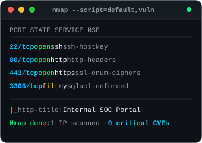

<!-- HEADER BANNER — Animated waving gradient -->
<div align="center">
  
</div>

<!-- TYPING SVG — Animated rotating text -->
<div align="center">
  <a href="https://git.io/typing-svg">
    
  </a>
</div>

<br/>

<!-- BLUE TEAM BADGE LINE + PROFILE VIEWS COUNTER -->
<div align="center">
  
  
  
  <br/><br/>
  
</div>

<br/>

<!-- ═══════════════════ ANIMATED DIVIDER ═══════════════════ -->


<!-- WHOAMI SECTION — with animated cyber GIF -->
<table>
<tr>
<td width="55%">

## 🧬 `whoami`

```python
profile = {
    "handle":   "ACESVAGE",
    "track":    "Blue Team / SOC Operations",
    "building": ["python-security-toolkit", "c-threat-hunter", "linux-admin-scripts"],
    "training": "TryHackMe (Pre-Security ✅ -> Cybersecurity 101 🔄 -> SOC Level 1)",
    "rule":     "Fundamentals first. No black-box tools.",
}
```

</td>
<td width="45%" align="center">


<br/><br/>

<br/>
<sub><i>🔒 Defending the perimeter...</i></sub>

</td>
</tr>
</table>

<!-- ═══════════════════ ANIMATED DIVIDER ═══════════════════ -->


## 🛡️ The Blue Team Arsenal

> *"The attacker only has to be right once. The defender has to be right every time."*

I'm venturing deep into the **Blue Team** side of the cyber landscape — focused on **detection, defense, and response**. Every tool I build, every script I write, and every packet I capture brings me closer to seeing what threat actors don't want me to see.

<div align="center">

### 🔧 Tools in My Toolkit

<table>
<tr>
<td align="center" width="140">
<br/>
<sub><b>Nmap & NSE</b></sub><br/>
<sub>Scripting Engine</sub>
</td>
<td align="center" width="140">
<br/>
<sub><b>Wireshark</b></sub><br/>
<sub>Packet Analysis</sub>
</td>
<td align="center" width="140">
<br/>
<sub><b>Nikto</b></sub><br/>
<sub>Web Vuln Scanning</sub>
</td>
<td align="center" width="140">
<br/>
<sub><b>Hydra</b></sub><br/>
<sub>Brute Force Audit</sub>
</td>
<td align="center" width="140">
<br/>
<sub><b>OWASP ZAP</b></sub><br/>
<sub>Web App Testing</sub>
</td>
</tr>
<tr>
<td align="center" width="140">
<br/>
<sub><b>Kali Linux</b></sub><br/>
<sub>Attack/Defense Lab</sub>
</td>
<td align="center" width="140">
<br/>
<sub><b>Packet Tracer</b></sub><br/>
<sub>Network Simulation</sub>
</td>
<td align="center" width="140">
<br/>
<sub><b>VirtualBox</b></sub><br/>
<sub>Lab Environments</sub>
</td>
<td align="center" width="140">
<br/>
<sub><b>Git</b></sub><br/>
<sub>Version Control</sub>
</td>
<td align="center" width="140">
<br/>
<sub><b>VS Code</b></sub><br/>
<sub>Dev Environment</sub>
</td>
</tr>
</table>

</div>

<!-- ═══════════════════ ANIMATED DIVIDER ═══════════════════ -->


## ⚔️ Languages & Technologies

<div align="center">
  
</div>

<br/>

<div align="center">

| Language | What I Use It For |
|:---:|:---|
| 🐍 **Python** | Security automation, recon tools, network scanning, log analysis |
| ⚙️ **C** | Low-level threat hunting, PE/ELF binary parsing, memory analysis |
| 🐚 **Bash** | Linux admin scripts, system hardening, network diagnostics |
| 🌐 **JavaScript / Node.js** | Full-stack web apps, backend APIs, security dashboards |
| ☕ **Java** | Advanced programming, Android development (Kotlin/Java) |

</div>

<!-- ═══════════════════ ANIMATED DIVIDER ═══════════════════ -->


## 🏆 GitHub Trophies

<div align="center">
  <!-- 
    NOTE: The upstream demo service (github-profile-trophy.vercel.app) has been paused by Vercel (HTTP 402 Payment Required).
    To restore trophies, deploy your own instance for free from https://github.com/ryo-ma/github-profile-trophy and update the endpoint URL.
  -->
  <a href="https://github.com/ryo-ma/github-profile-trophy">
    
  </a>
  <br/><br/>
  <sub><i>🏆 Showcase temporarily paused while upstream Vercel deployment is offline. Check live activity and streaks below!</i></sub>
</div>

<!-- ═══════════════════ ANIMATED DIVIDER ═══════════════════ -->


## 🗡️ Featured Repositories — The Arsenal

<div align="center">

[](https://github.com/ACESVAGE/python-security-toolkit)
[](https://github.com/ACESVAGE/c-threat-hunter)
[](https://github.com/ACESVAGE/linux-admin-scripts)
[](https://github.com/ACESVAGE/ledgr_fixed)

</div>

### 🔍 What's Inside

<details>
<summary>🛡️ <b>python-security-toolkit</b> — 30-script Python security suite (8/30 deployed)</summary>
<br/>

A structured **30-script toolkit** covering the full security lifecycle. Currently **8 scripts deployed** with the recon phase complete and network scanning underway:

| Module | Scripts | What It Does |
|--------|---------|-------------|
| `recon/` | `whois_lookup.py`, `dns_resolver.py`, `subdomain_enum.py`, `web_recon.py`, `email_harvester.py` | OSINT, domain intel, subdomain brute-forcing, web tech fingerprinting |
| `scanning/` | `host_discovery.py`, `port_scanner.py` | Ping sweeps, ARP scanning, TCP Connect/SYN port scanning & service detection |
| `hardening/` | 🔄 *Coming soon* | Password auditing, SSH config checks, SSL validation |
| `log-analysis/` | 🔄 *Coming soon* | Brute-force detection, intrusion pattern matching, file integrity |
| `crypto/` | 🔄 *Coming soon* | Hash cracking, cipher tools, steganography |
| `automation/` | 🔄 *Coming soon* | Full audit reports, CVE monitoring, incident triage |

</details>

<details>
<summary>🎯 <b>c-threat-hunter</b> — 20-program C malware & threat hunting suite (1/20 deployed)</summary>
<br/>

A low-level **20-program C suite** exploring OS internals, malware detection, and binary analysis (Win32 & POSIX). Currently **1 program deployed** with Phase 1 static analysis underway:

| Phase | Module | Programs | What It Does |
|---|---|---|---|
| `Phase 1` | `static-analysis/` | `pe_header_parser.c` (✅ deployed), `elf_header_parser.c` (⏳ next), `section_entropy.c`, `string_extractor.c`, `hash_validator.c` | DOS/NT headers, section mapping, imports/exports, entropy calculation, string carving |
| `Phase 2` | `process-inspection/` | 🔄 *Coming soon* (`proc_enumerator.c`, `hollowing_detector.c`, etc.) | Snapshot inspection, DLL enumeration, thread start auditing, process hollowing detection |
| `Phase 3` | `memory-analysis/` | 🔄 *Coming soon* (`page_perms_audit.c`, `pattern_scanner.c`, etc.) | RWX page auditing, memory scanning, memory dumps, VAD tree walking |
| `Phase 4` | `system-integrity/` | 🔄 *Coming soon* (`autorun_auditor.c`, `hook_detector.c`, etc.) | Run keys, inline API hooks (ntdll detours), driver auditing, real-time FIM |

- Built with **C11**, cross-platform (MinGW / GCC / Clang / MSVC)
- Includes standalone compilation scripts, unified Makefiles, and modular headers

</details>

<details>
<summary>🐧 <b>linux-admin-scripts</b> — 30-script Bash sysadmin & security suite (5/30 deployed)</summary>
<br/>

A structured **30-script Bash suite** covering Linux administration and cybersecurity automation. Currently **5 scripts deployed** in Phase 1 (Foundation):

| Phase | Module | Scripts | What It Does |
|---|---|---|---|
| `Phase 1` | `admin/` | `user_management.sh`, `disk_management.sh`, `network_management.sh`, `backup_restore.sh` | Interactive user/group administration, storage diagnostics & quotas, network diagnostics & firewall rules, tar/rsync incremental backups |
| `Phase 2` | `cybersecurity/scanning` & `recon` | 🔄 *Coming soon* (`host_discovery.sh`, `port_scanner.sh`, `subdomain_enum.sh`, etc.) | Ping sweeps, port scanning, OSINT domain reconnaissance, system hardening |
| `Phase 3` | `cybersecurity/log-analysis` | 🔄 *Coming soon* (`failed_login_detector.sh`, `intrusion_detector.sh`, etc.) | Failed login & brute-force detection, file integrity checking, network traffic monitoring |
| `Phase 4` | `cybersecurity/ctf` | 🔄 *Coming soon* (`web_recon.sh`, `hash_cracker_helper.sh`, etc.) | Web directory busting, password hash cracking assistance, CTF utilities |

- Tested across **Ubuntu, Debian, Fedora, CentOS, RHEL, and Arch**
- Robust error handling (`set -euo pipefail`), root privilege verification, and ANSI colorized outputs

</details>

<details>
<summary>💰 <b>ledgr_fixed</b> — Full-stack Finance Management Web App</summary>
<br/>

A complete **Node.js/Express** web application for retail store finance management:

- 📊 Dashboard with analytics, payroll, billing, and tax modules
- 🔐 Authentication system with middleware-based access control
- 🐘 PostgreSQL database with Docker containerization
- 📱 Responsive UI with EJS templating

</details>

<!-- ═══════════════════ ANIMATED DIVIDER ═══════════════════ -->


## 🧠 Nmap Scripting Engine (NSE) — A Key Weapon

<table>
<tr>
<td>

```bash
# 🔍 My go-to NSE recon workflow
nmap -sV --script=default,vuln,banner <target>

# 🕸️ Web enumeration
nmap --script http-enum,http-title,http-headers -p 80,443 <target>

# 🔐 Brute-force audit
nmap --script ssh-brute,ftp-brute \
  --script-args userdb=users.txt,passdb=pass.txt <target>

# 🛡️ Vulnerability assessment
nmap --script vuln --script-args=unsafe=1 -sV <target>
```

</td>
<td width="300" align="center">


<br/><br/>

<br/>
<sub><i>🔍 Scanning the network...</i></sub>

</td>
</tr>
</table>

> I leverage NSE scripts heavily alongside my **custom Python recon tools** to build comprehensive target profiles during authorized assessments.

<!-- ═══════════════════ ANIMATED DIVIDER ═══════════════════ -->


## 🗺️ The Roadmap — What's Next

```
🔄 Currently Building:
├── 🐍 Python Toolkit: Network scanning (host_discovery ✅, port_scanner ✅, banner_grabber ⏳)
├── ⚙️ C Threat Hunter: Static analysis (pe_header_parser ✅, elf_header_parser ⏳)
├── 🐧 Linux Admin Suite: Core sysadmin (user_mgmt ✅, disk_mgmt ✅, net_mgmt ✅, backup ✅, monitor ⏳)
└── 🔐 Hardening & Memory analysis: SSH auditor, SSL validator & RWX detection

🎯 On the Horizon:
├── 🏴 CTF challenge scripts & writeups
├── 📡 SIEM integration & log correlation
├── 🕵️ Full incident response automation
└── 🧪 Malware analysis sandbox tooling
```

<!-- ═══════════════════ ANIMATED DIVIDER ═══════════════════ -->


## 🎓 Certifications — The Foundation Path

<div align="center">

> *"Getting the fundamentals right isn't optional — it's the bedrock everything else is built on."*

</div>

Every certification and learning path here was a **deliberate milestone — not a checkbox**. These credentials were chosen to build the mental model before the muscle memory — covering cybersecurity theory, industrial threat environments, enterprise Linux, and hands-on lab-driven practice. Each one connects directly to the Blue Team work I'm building toward.

<br/>

```
🛡️  CERTIFICATION PATH — FOUNDATION PHASE
══════════════════════════════════════════════════════════════════════════

  ◉ [ START ] Zero → Security Mindset
  │
  │
  ├──▶  🔵  Cybersecurity Fundamentals · IBM SkillsBuild ........... ✅ VERIFIED
  │         "IBM forced me to think about the why before the how.
  │          CIA triad, risk frameworks, attack anatomy — the
  │          starting gun. Without this, you're just running
  │          commands you don't understand."
  │         [ CIA Triad ] [ Threat Intel ] [ Risk Mgmt ] [ IAM ] [ Cryptography ]
  │
  ├──▶  🟡  Industrial Cybersecurity Essentials · Cisco ............. ✅ VERIFIED
  │         "OT/ICS is one of the most underestimated attack
  │          surfaces. Where availability beats confidentiality.
  │          Where a compromise means a power grid going dark —
  │          not just a data breach."
  │         [ ICS/SCADA ] [ Purdue Model ] [ OT Protocols ] [ IT-OT Boundary ]
  │
  ├──▶  🔴  Red Hat System Administration I (RH124) · Red Hat ....... ✅ VERIFIED
  │         "You can't secure what you can't administer. RH124
  │          is how you go from Linux user to Linux operator.
  │          This powers my entire linux-admin-scripts toolkit."
  │         [ RHEL ] [ systemd ] [ LVM ] [ SELinux ] [ firewalld ] [ SSH ]
  │
  ├──▶  🟢  TryHackMe — Cybersecurity Learning Path ................. 🔄 IN PROGRESS
  │         Hands-on, lab-driven training covering attack techniques,
  │         detection methods, and real Blue Team operations.
  │         Progress updates posted as each module is completed.
  │         │
  │         ├── Pre-Security .................................... ✅ COMPLETED
  │         ├── Cybersecurity 101 ............................... 🔄 IN PROGRESS
  │         └── SOC Level 1 .................................... ⏳ UP NEXT
  │
  └──▶  ◎  CompTIA Security+  ·  Cisco CyberOps Associate ....... 🎯 On the Horizon

══════════════════════════════════════════════════════════════════════════
```

<br/>

---

<div align="center">

### 🏅 Verified Credentials

| Certification | Issuer | Verify |
|:---|:---|:---:|
| 🔵 Cybersecurity Fundamentals | IBM SkillsBuild | [🏅 Credly](https://www.credly.com/badges/4c332087-d42d-4f99-9b9a-3e8b0b377d4d/public_url) |
| 🟡 Industrial Cybersecurity Essentials | Cisco | [🏅 Credly](https://www.credly.com/badges/e86c445a-2f7d-4e4f-b007-7d5d61b9aa86/public_url) |
| 🔴 Red Hat System Administration I — RH124 Ver.10 | Red Hat | [🏅 Credly](https://www.credly.com/badges/b0a066bf-3398-4229-bfb9-ab5c10852f00/public_url) |
| 🟢 Pre-Security Learning Path | TryHackMe | [🏅 TryHackMe](https://tryhackme.com/p/brooklynkidiga) |

</div>

---

### 🟢 Currently Pursuing — TryHackMe Cybersecurity Learning Path

<table>
<tr>
<td width="58%">

**📌 Platform:** TryHackMe &nbsp;|&nbsp; **🗓️ Status:** 🔄 Active

**💬 Why TryHackMe:**

Theory only takes you so far. TryHackMe bridges the gap between knowing concepts and actually applying them in realistic conditions. The platform's browser-based labs mean I'm not just reading about port scanning, log analysis, or threat detection — I'm doing it in live environments, against real targets, in structured scenarios that mirror actual SOC workflows.

The progression I'm working through is deliberate — Pre-Security builds the networking and Linux fundamentals, Cybersecurity 101 locks in the core security concepts hands-on, and SOC Level 1 is where it all comes together: real threat detection, SIEM workflows, and alert triage in a simulated Security Operations Center.

**🗺️ Path Progression:**

| Module | Focus | Status |
|:---|:---|:---:|
| Pre-Security | Networking, Linux, Windows & Web fundamentals | ✅ Completed |
| Cybersecurity 101 | Core security concepts hands-on | 🔄 In Progress |
| SOC Level 1 | Threat detection, SIEM, alert triage | ⏳ Up Next |

<details>
<summary>📦 <b>Pre-Security Path Breakdown (5/5 Modules Completed)</b></summary>
<br/>

| Module | Core Concepts & Labs Covered | Status |
|:---|:---|:---:|
| 🌐 **Network Fundamentals** | Networking concepts, LANs, OSI model, Packets & Frames, Extending networks | ✅ Completed |
| 🌍 **How the Web Works** | DNS in detail, HTTP/HTTPS in detail, Web server architectures | ✅ Completed |
| 🐧 **Linux Fundamentals** | Linux navigation, directory hierarchy, user permissions, process & package management | ✅ Completed |
| 🪟 **Windows Fundamentals** | Windows filesystem, Desktop/CLI navigation, Control Panel, Task Manager & Registry | ✅ Completed |
| 🛡️ **Cyber Security Intro** | CIA triad, offensive vs. defensive security models, basic web vulnerabilities | ✅ Completed |

</details>

</td>
<td width="42%" align="center">


<br/><br/>


<br/><br/>


<br/><br/>

<a href="https://tryhackme.com/p/brooklynkidiga">
  
</a>

<br/><br/>

<sub><i>🎯 Profile updated as each<br/>module is completed</i></sub>

</td>
</tr>
</table>

---

<div align="center">

<sub><i>🎯 These are the foundations. More certifications actively being pursued as I advance deeper into the Blue Team landscape.</i></sub>

<br/><br/>

<a href="https://www.credly.com/users/brooklyn-kidiga">
  
</a>

</div>

<!-- ═══════════════════ ANIMATED DIVIDER ═══════════════════ -->


## 🐍 Contribution Snake

<div align="center">

<picture>
  <source media="(prefers-color-scheme: dark)" srcset="https://raw.githubusercontent.com/ACESVAGE/ACESVAGE/output/github-snake-dark.svg">
  <source media="(prefers-color-scheme: light)" srcset="https://raw.githubusercontent.com/ACESVAGE/ACESVAGE/output/github-snake.svg">
  
</picture>

<sub><i>🐍 Watch the snake devour my contributions</i></sub>

</div>

<!-- ═══════════════════ ANIMATED DIVIDER ═══════════════════ -->


## 📊 GitHub Stats

<div align="center">
  
  
</div>

<br/>

<div align="center">
  
</div>

<br/>

<div align="center">
  
</div>

<!-- ═══════════════════ ANIMATED DIVIDER ═══════════════════ -->


## 🌐 Connect

<div align="center">
  <a href="https://github.com/ACESVAGE">
    
  </a>
  <a href="mailto:brooklynkidiga@gmail.com">
    
  </a>
</div>

<br/>

---

<!-- FOOTER BANNER — Animated waving gradient -->
<div align="center">
  
</div>

<div align="center">
  
</div>
